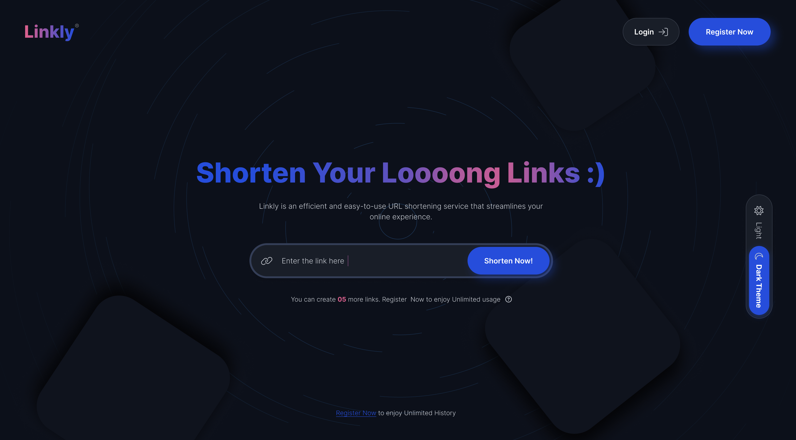
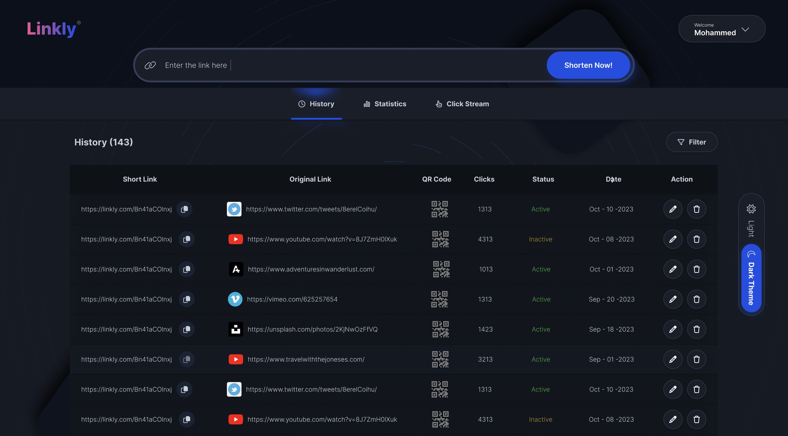
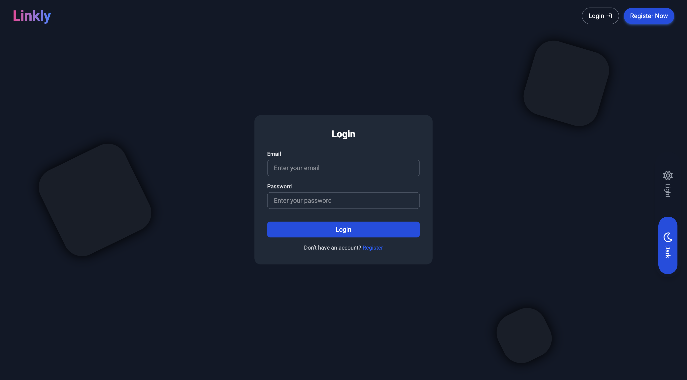
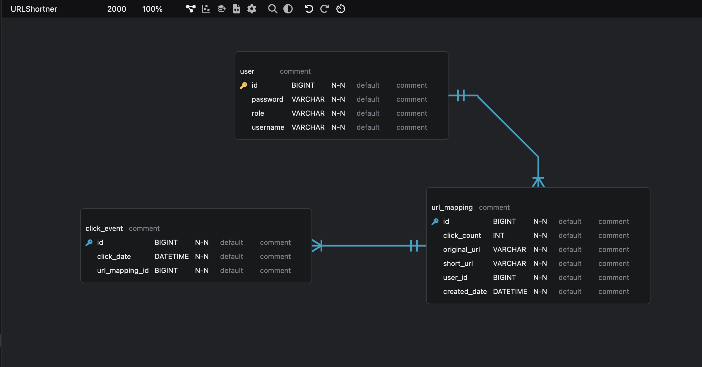

# URL Shortener

This is a web application to shorten URLs, where users can sign up, sign in, create short links, view click streams, history, and statistics.

## Acknowledgements

- [React](https://react.dev/)
- [Spring Boot](https://spring.io/projects/spring-boot)

## API Reference

base = /api

### 1. Auth
| METHOD | PATH | DESCRIPTION |
| :-------- | :------- | :------------------------- |
| `POST` | `/auth/public/register` | new user registration |
| `POST` | `/auth/public/login` | user login |

### 2. URL Shortening
| METHOD | PATH | DESCRIPTION |
| :-------- | :------- | :------------------------- |
| `POST` | `/urls/shorten` | create short URL |
| `GET` | `/urls` | list user URLs |
| `GET` | `/s/{shortUrl}` | redirect to original URL |

### 3. Analytics
| METHOD | PATH | DESCRIPTION |
| :-------- | :------- | :------------------------- |
| `GET` | `/urls/{id}/clicks` | click stream data |
| `GET` | `/urls/{id}/stats` | URL statistics |

## Screenshots






## Features

- sign up, sign in
- URL shortening
- click stream analytics
- history and statistics
- responsive web design
- secured REST endpoints

## Built With

- React.js
- Vite
- Spring Boot
- MySQL

## Prerequisites

- Maven
- Node package manager (npm)
- MySQL
- Spring Boot Framework
- ReactJS

## Setup

### Backend (Spring Boot)
1. Start MySQL and create database `urlshortenerDB`.
2. Update `url-shortener-spring-boot/src/main/resources/application.properties` if needed.
3. Run:
   ```
   cd url-shortener-spring-boot
   mvn spring-boot:run
   ```
   Backend runs on `http://localhost:8080`.

### Frontend (React)
1. Install dependencies:
   ```
   cd url-shortener-react
   npm install
   ```
2. Run dev server:
   ```
   npm run dev
   ```
   Frontend runs on `http://localhost:5173`.

## License

- This project is licensed under the [MIT](https://choosealicense.com/licenses/mit/)

## Authors

- [@ShashankOO7](https://www.github.com/ShashankOO7)
